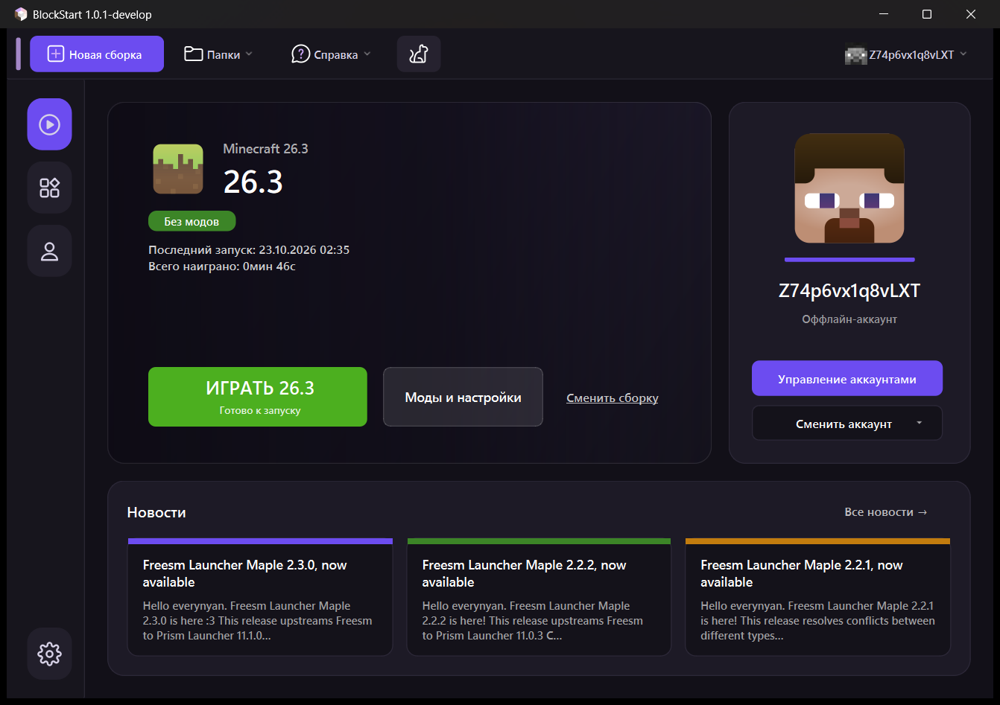

# BlockStart

Лаунчер Minecraft с простым и понятным интерфейсом. Основан на [Freesm Launcher](https://github.com/FreesmTeam/FreesmLauncher).



## Что изменено

- **Главная страница**: карточка выбранной сборки с версией, загрузчиком модов, временем игры и большой кнопкой «Играть». Пока игра запущена, кнопка превращается в «Остановить».
- **Боковое меню**: «Главная», «Сборки», «Аккаунты», «Настройки».
- **Карточка аккаунта** со скином в полный рост и кнопками «Управление аккаунтами» и «Сменить аккаунт».
- **Новости** лаунчера в виде карточек на главной.
- **Упрощённая панель сборки**: «Играть», «Изменить», «Папка», а редкие действия собраны в меню «Ещё».
- **Тёмная верхняя панель** с кнопкой «Новая сборка».
- Единая терминология в русском переводе: везде «сборка».

## Скачать

Готовая переносная версия для Windows лежит в разделе [Releases](../../releases). Распакуйте архив и запустите `BlockStart.exe`. Установка не нужна, все данные хранятся рядом с программой.

## Сборка из исходников (Windows)

Нужны [MSYS2](https://www.msys2.org/) (окружение CLANG64 с Qt 6) и JDK 17 в `C:\msys64\opt\jdk`.

```powershell
.\dev-build.ps1        # отладочная сборка и запуск
.\release-build.ps1    # переносная версия в dist\
```

Скрипты собирают проект через ссылку `C:\dev\freesm`, потому что инструменты Qt не работают с кириллицей в пути.

Сборка под другие системы описана в документации оригинального проекта: [docs/README.md](docs/README.md).

## Лицензия

GPL-3.0, как и у оригинального проекта. См. [LICENSE](LICENSE) и [docs/COPYING.md](docs/COPYING.md).
